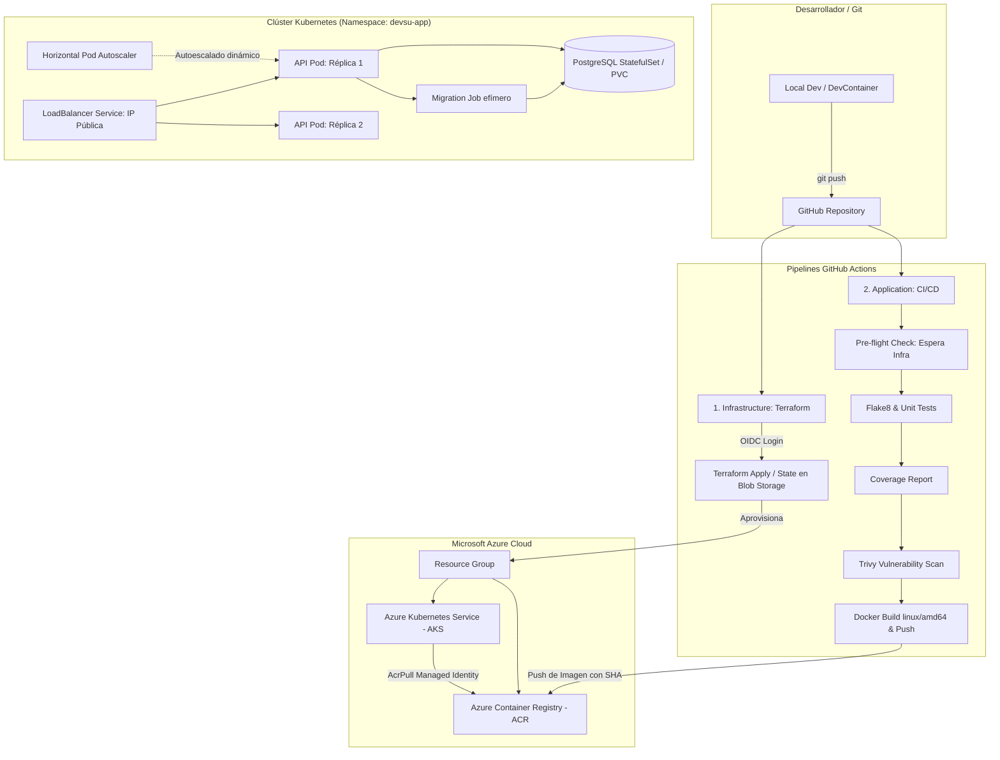

# 🚀 DevOps Challenge - API REST Django en Azure AKS

[](https://github.com)
[](https://github.com)

Solución integral para el desafío técnico de DevOps. El proyecto implementa una arquitectura nativa de la nube (*Cloud-Native*) basada en microservicios contenerizados, aprovisionamiento automatizado con **Terraform**, autenticación de seguridad **OIDC (Passwordless)**, despliegue en **Azure Kubernetes Service (AKS)** con alta disponibilidad, y pipelines de entrega continua con **GitHub Actions** y **Makefile**.

---

## 📌 Enlaces Rápidos y Entregables

* **🌐 URL Pública de la API (Producción en vivo):**  
  👉 `http://20.72.147`
* **⚙️ Pipelines en GitHub Actions (Trazabilidad Pública):**  
  * [Pipeline 1: Infrastructure (Terraform AKS via Make)](https://github.com)
  * [Pipeline 2: Application CI/CD (via Makefile)](https://github.com)

---

## 🏗️ 1. Arquitectura General del Sistema

El siguiente diagrama describe el flujo automatizado: desde el control de versiones hasta el despliegue en el clúster de Kubernetes en Azure.



---

## 📂 2. Estructura del Proyecto

A continuación se detalla la organización de los archivos y directorios principales del repositorio:

```text
├── .devcontainer/              # Entorno de desarrollo aislado en VS Code (Python 3.11 + Postgres)
├── .github/
│   └── workflows/
│       ├── infra-terraform-aks.yaml  # Workflow 1: Aprovisionamiento de AKS y ACR
│       └── app-ci-cd.yaml             # Workflow 2: CI/CD automatizado con pre-flight check
├── app/                        # Código fuente de Django
│   ├── api/                    # Modelos, Vistas, Serializers y Tests
│   ├── demo/                   # Configuración global y Settings de Django
│   └── manage.py               # Utilidad CLI de Django
├── aks/                        # Manifiestos declarativos de Kubernetes (Namespace: devsu-app)
│   ├── 00-namespace.yaml       # Namespace dedicado
│   ├── 01-postgres.yaml        # Deployment + PVC + Service para PostgreSQL
│   ├── 02-configmap.yaml       # Variables de entorno no sensibles
│   ├── 03-secret.yaml          # Secretos de base de datos y Django Secret Key
│   ├── 04-migration-job.yaml   # Job efímero para correr migraciones de forma segura
│   ├── 05-api-deployment.yaml  # Deployment de la API (2 réplicas, Liveness/Readiness probes)
│   ├── 06-api-service.yaml     # Service LoadBalancer (IP Pública en Azure)
│   └── 07-api-hpa.yaml         # Horizontal Pod Autoscaler (Escalado por CPU)
├── infra/                      # Código IaC de Terraform (AKS, ACR, Red)
│   ├── main.tf
│   ├── variables.tf
│   ├── outputs.tf
│   └── providers.tf
├── Dockerfile                  # Multi-stage Dockerfile de producción (Non-root user + Gunicorn)
├── Makefile                    # Estandarización de comandos para Local y Pipelines
└── requirements.txt            # Dependencias (Django, DRF, Gunicorn, Psycopg2, Coverage)
```

---

## 🛠️ 3. Automatización con Makefile

El proyecto incluye un archivo `Makefile` para estandarizar el ciclo de desarrollo tanto en local como dentro de los runners de CI/CD:

```bash
# Entorno Local / Desarrollo
make install          # Instala dependencias locales
make test             # Ejecuta la suite de pruebas unitarias con Coverage
make lint             # Valida el estilo del código con Flake8

# Infraestructura e IaC (Ejecutado por el Pipeline de Infra)
make infra-init       # Inicializa el backend remoto de Terraform
make infra-plan       # Genera el plan de ejecución de la infraestructura
make infra-apply      # Aplica y aprovisiona los recursos en Azure (AKS, ACR)

# Despliegue en Kubernetes (Ejecutado por el Pipeline de la App)
make k8s-deploy       # Aplica los manifiestos e inyecta la imagen con el SHA del commit
```

---

## 🛡️ 4. Estrategia de Seguridad y Buenas Prácticas
1. **Autenticación OIDC (Passwordless):** SQLite es un archivo plano local incompatible con entornos multi-réplica (replicas >= 2). Se desacopló la base de datos a un servicio dedicado de PostgreSQL 15 respaldado por un disco persistente (PVC)
2. **Autenticación OIDC (Passwordless):** Los pipelines de GitHub Actions se conectan a Microsoft Azure de manera segura mediante *OpenID Connect*, eliminando la necesidad de almacenar credenciales persistentes (`AZURE_CREDENTIALS`) en los secretos del repositorio.
3. **Desacoplamiento Inteligente con Pre-flight Check:** El pipeline de la aplicación incluye una fase de validación inicial que consulta el estado de Azure y espera de forma automatizada a que la infraestructura de Terraform esté completamente lista antes de iniciar las pruebas y el despliegue.
3. **Paridad Local y CI/CD mediante Makefile:**as tareas críticas (compilación, pruebas, init de Terraform y despliegue en AKS) están estandarizadas en un Makefile, garantizando que el desarrollador ejecute localmente exactamente lo mismo que corre en la nube.
4. **Aislamiento por Namespaces (devsu-app):** Se evita el uso del namespace default, aplicando gobernanza, segmentación lógica y control del ciclo de vida de los recursos de forma aislada.

---


## 🧪 5. Validación y Pruebas del Servicio

Puedes validar el correcto funcionamiento de la API REST ejecutando los siguientes comandos desde tu terminal:

### 1. Consultar Todos los Usuarios (GET)
```bash
curl -X GET http://IP-PUBLICA/api/users/
```

**Respuesta esperada:**
```json
[]
```

### 2. Crear un Nuevo Usuario (POST)
```bash
curl -X POST http://20.72.147.22/api/users/ \
  -H "Content-Type: application/json" \
  -d '{"dni": "0987654123", "name": "UserDevOps"}'
```

**Respuesta esperada (HTTP 201 Created):**
```json
  {
    "id": 2,
    "dni": "0987654123",
    "name": "UserDevOps"
  }
```

### 3. Verificar Recursos en el Clúster
Si tienes acceso al contexto de Kubernetes, puedes verificar el estado de los recursos desplegados ejecutando:
```bash
kubectl get pods,svc,hpa -n devsu-app
```

---

## 👤 Autor

* **Ing DevOps:** Romel Tenesaca
* **Repositorio GitHub:** [github.com/devrtenesaca/devsu-coderpad](https://github.com)